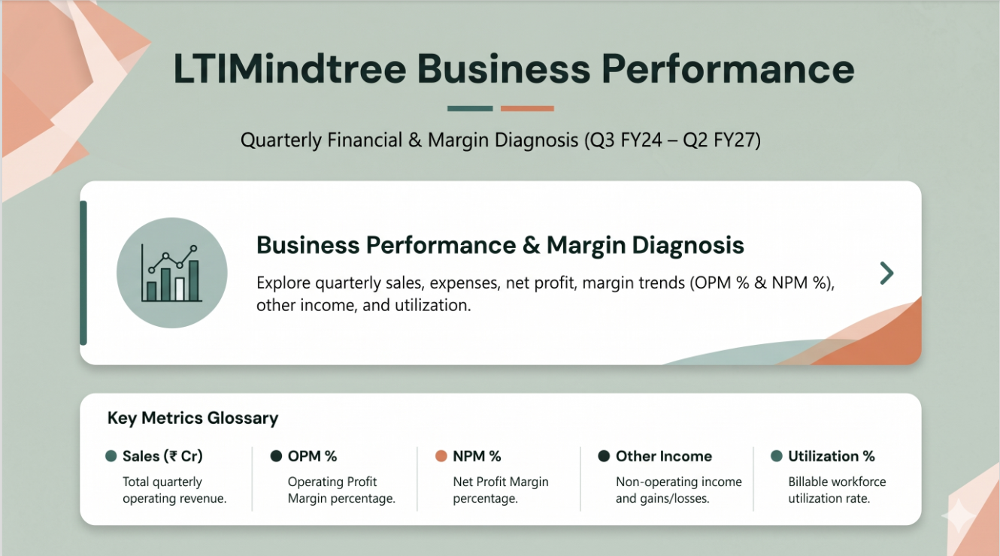
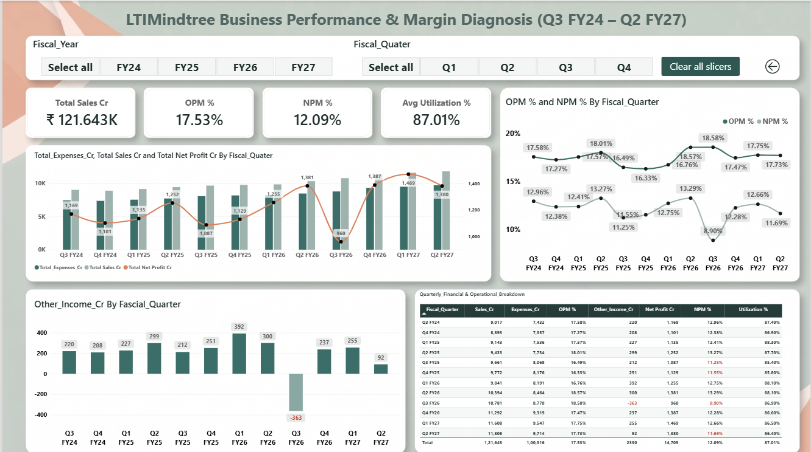

# LTIMindtree Business Performance & Margin Diagnosis (Q3 FY24 – Q2 FY27)

A financial analytics project that investigates **why LTIMindtree's net profit margin declined even though revenue grew steadily**, using 12 consecutive quarters of financial and operational data. The project combines a Python (pandas) data-preparation notebook, an interactive Power BI dashboard, and a one-page executive summary.

---

## Business Question

> Why is the company's net margin declining despite steady revenue growth, and what three specific actions should management take?

## Key Findings (at a glance)

| Metric | Q3 FY24 | Q2 FY27 | Change |
|---|---|---|---|
| Quarterly sales | ₹9,017 Cr | ₹11,808 Cr | **+30.95%** |
| Operating expenses | ₹7,432 Cr | ₹9,714 Cr | **+30.71%** |
| Operating margin (OPM %) | 17.58% | 17.73% | +0.15 pp |
| Net profit margin (NPM %) | 12.96% | 11.69% | **−1.27 pp** |
| Billable utilization | 87.4% | 86.4% | −1.00 pp |

12-quarter aggregates: total sales **₹1,21,643 Cr**, sales-weighted OPM **17.53%**, sales-weighted NPM **12.09%**, average utilization **87.01%**, lowest NPM **8.90%** (Q3 FY26).

**Diagnosis in brief**

1. **Core operations are stable.** OPM is flat end-to-end (+0.15 pp) and peaked at 18.58% in Q3 FY26, so this is not a demand problem.
2. **Other Income volatility hits the bottom line.** Other Income swung from ₹220 Cr (Q3 FY24) to **−₹363 Cr** (Q3 FY26, pulling NPM to 8.90%) and **₹92 Cr** (Q2 FY27).
3. **Expenses grew almost one-for-one with sales** (30.71% vs 30.95%), leaving little operating leverage, while utilization slipped from 87.4% to 86.4%.
4. **Four quarters breached the 12.0% NPM benchmark:** Q3 FY25 (11.25%), Q4 FY25 (11.55%), Q3 FY26 (8.90%) and Q2 FY27 (11.69%).

### Recommendations

1. **Tighten FX hedging and treasury controls** to stabilise Other Income.
2. **Lift billable utilization back above 88%.**
3. **Enforce a 12.0% NPM guardrail** with expense discipline and early pricing/cost action.

The full write-up is in [`Executive_Summary_-_LTIMindtree_Margin_Diagnosis.pdf`](Executive_Summary_-_LTIMindtree_Margin_Diagnosis.pdf).

### Supporting check: where the 1.27 pp went

Measured as a % of sales, Q3 FY24 → Q2 FY27:

| Line item | Q3 FY24 | Q2 FY27 | Change (pp of sales) |
|---|---|---|---|
| Operating profit | 17.58% | 17.73% | +0.15 |
| Other income | 2.44% | 0.78% | **−1.66** |
| Interest | 0.68% | 0.59% | +0.08 (lower cost) |
| Depreciation | 2.21% | 2.16% | +0.05 (lower cost) |
| **Profit before tax (PBT)** | **17.13%** | **15.75%** | **−1.38** |

The fall in Other Income as a share of sales accounts for more than the entire decline in PBT margin. Net profit as a share of PBT also eased slightly (75.7% → 74.2%), which explains the remainder of the gap between the PBT and NPM changes. These figures were derived from the dataset in this repo.

---

## Repository Contents

| File | Description |
|---|---|
| `LTIMindtree_Quarterly_Financial_Data.csv` | Raw dataset: 12 quarters × 26 columns |
| `LTIMindtree_Business_Performance___Margin_Diagnosis__Q3_FY24___Q2_FY27_.ipynb` | Jupyter notebook: loading, inspection, cleaning and feature engineering |
| `ltim_cleaned.csv` | Cleaned output of the notebook (12 rows × 29 columns); the data source for the Power BI report |
| `LTIMindtree_Business_Performance___Margin_Diagnosis__Q3_FY24___Q2_FY27_.pbix` | Power BI dashboard |
| `Executive_Summary_-_LTIMindtree_Margin_Diagnosis.pdf` | Two-page executive summary with findings and recommendations |
| `01_home.png`, `02_overview_dashboard.png` | Dashboard screenshots shown in this README |

> Tip: if you rename files for GitHub (for example, shorter names without the triple underscores), update the filenames referenced in this README and in the notebook.

---

## Dataset

**Coverage:** 12 quarters, Q3 FY24 (Dec 2023) to Q2 FY27 (Sep 2026). Amounts are in ₹ crore (Cr) unless stated otherwise.

| Group | Columns |
|---|---|
| Period | `Quarter_Index`, `Quarter_End`, `Fiscal_Quarter`, `Fiscal_Year` |
| Income statement | `Sales_Cr`, `Expenses_Cr`, `Operating_Profit_Cr`, `OPM_Pct`, `Other_Income_Cr`, `Interest_Cr`, `Depreciation_Cr`, `PBT_Cr`, `Net_Profit_Cr`, `NPM_Pct`, `EPS_INR` |
| Operational | `Headcount`, `Utilization_Pct`, `TTM_Attrition_Pct`, `DSO_Days`, `Active_Clients` |
| Growth and ratios | `QoQ_Sales_Growth_Pct`, `YoY_Sales_Growth_Pct`, `YoY_Expense_Growth_Pct`, `YoY_Net_Profit_Growth_Pct`, `Expense_to_Sales_Pct`, `Rev_Per_Employee_Lakhs` |

**Columns added by the notebook** (in `ltim_cleaned.csv`):

| Column | Definition |
|---|---|
| `q_date` | Quarter-end text (e.g. `Dec 2023`) parsed to a datetime (first day of the month) |
| `cost_per_emp_lakhs` | `Expenses_Cr × 100 / Headcount` (₹ lakh per employee) |
| `op_profit_per_emp_lakhs` | `Operating_Profit_Cr × 100 / Headcount` (₹ lakh per employee) |

**Known characteristics**

- Expected nulls only: `QoQ_Sales_Growth_Pct` has 1 null (first quarter) and the three `YoY_*` columns have 4 nulls each (the first four quarters have no prior-year comparison).
- `Operating_Profit_Cr`, `PBT_Cr` and `Net_Profit_Cr` reconcile to within ₹1 Cr of the line items (rounding in the source figures).
- **Data provenance is not documented in this repo.** Add the source of the financial and operational figures (for example, company filings or investor presentations) before sharing publicly.

---

## Methodology

1. **Load and inspect** the raw CSV: shape, columns, head/tail, null counts, `info()` and `describe()`.
2. **Clean:** strip whitespace from text fields, parse `Quarter_End` into a proper date, and sort chronologically.
3. **Engineer features:** cost and operating profit per employee.
4. **Export** `ltim_cleaned.csv`.
5. **Visualise** in Power BI to compare operating-margin stability against net-margin swings, track expense growth against sales growth, and flag quarters below the 12.0% NPM benchmark.

The notebook covers steps 1–4; the diagnostic analysis in step 5 was performed in Power BI and is summarised in the PDF.

---

## Power BI Dashboard

Open the `.pbix` file with **Power BI Desktop** (Windows). It contains two pages:

- **Homepage:** a landing page with a navigation button.
- **Overview:**
  - KPI cards: Total Sales, OPM %, NPM %, Avg Utilization %
  - OPM % vs NPM % trend by fiscal quarter (line chart)
  - Sales and Expenses with Net Profit by fiscal quarter (combo chart)
  - Other Income by fiscal quarter (column chart; this is the view that exposes the Q3 FY26 negative)
  - Quarter-level detail table (Sales, Expenses, Other Income, Net Profit, OPM %, NPM %, Avg Utilization %)
  - Slicers for Fiscal Year and Quarter, a "Clear all slicers" button and a back button

The report is connected to `ltim_cleaned.csv`. If Power BI cannot find the file, go to **Home → Transform data → Data source settings** and point it to your local copy.

---

## How to Reproduce

**Requirements:** Python 3.x, `pandas`, Jupyter (the notebook was run on Python 3.13.9).

```bash
pip install pandas jupyter
jupyter notebook
```

Open the `.ipynb` file and run all cells. Keep `LTIMindtree_Quarterly_Financial_Data.csv` in the same folder as the notebook. The notebook regenerates `ltim_cleaned.csv`.

---

## Limitations

- Only 12 data points, so correlations are indicative rather than statistically robust.
- The Other Income swings are measured in the data, but their **cause** (for example, FX or treasury losses) is an inference; the dataset does not break Other Income into components.
- Utilization is a supporting factor rather than a complete explanation. Net margin was above 12% in several quarters with utilization below 87% (for example Q4 FY26 at 86.6% utilization and 12.28% NPM). The Q3 FY25 and Q4 FY25 breaches were driven mainly by lower operating margin (16.49% and 16.33%), not by Other Income.
- The 12.0% NPM benchmark is an internal review threshold used in this analysis, not an official company target.

---

## Tools Used

Python · pandas · Jupyter Notebook · Power BI · CSV

## Dashboard Screenshots

### 1. Home Page



*Landing page with a navigation button to the report and a glossary of key metrics (Sales, OPM %, NPM %, Other Income, Utilization %).*

### 2. Business Performance & Margin Diagnosis – Overview



*Overview page with KPI cards, OPM % vs NPM % trend, sales/expenses/net profit combo chart, Other Income by quarter, and a quarter-level detail table, filterable by fiscal year and quarter.*
